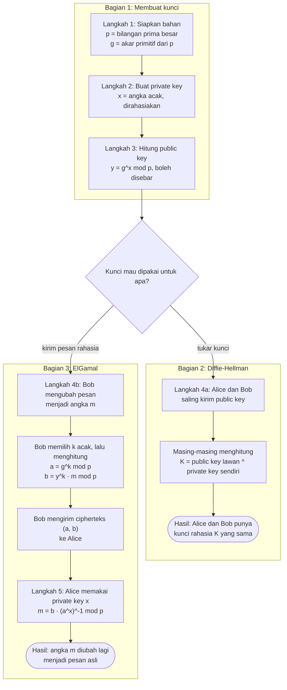
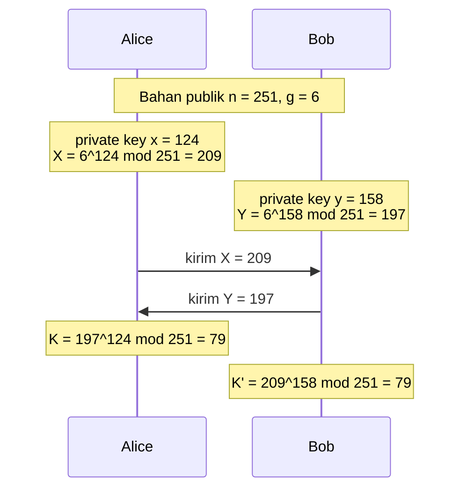

# Diffie-Hellman & ElGamal — Kelompok 11 (Kriptografi)

Implementasi **pertukaran kunci Diffie-Hellman** dan **algoritma ElGamal**
sepenuhnya manual: **tanpa library atau framework kriptografi jadi**. Seluruh
operasi (eksponensiasi modular, Euclid, invers modular, Miller-Rabin, akar
primitif, pemecahan blok pesan) ditulis sendiri. Satu-satunya modul standar
untuk logika inti adalah `random.SystemRandom` (sumber bilangan acak).

## Anggota:

| Nama                   | NRP        |
|------------------------|------------|
| Kanafira Vanesha Putri | 5027241010 |
| Fika Arka Nuriyah      | 5027241071 |
| S. Farhan Baig         | 5027241097 |

## Struktur project

```
kelompok11_dh_elgamal/
├── main.py                  # menu interaktif (semua tahapan, tampilkan langkah)
├── README.md
├── crypto/
│   ├── __init__.py
│   ├── math_utils.py        # mod_exp, gcd, extended Euclid, invers, Miller-Rabin,
│   │                        # prima aman, akar primitif, logaritma diskrit brute force
│   ├── diffie_hellman.py    # parameter, nilai publik, kunci sesi, run_exchange
│   ├── elgamal.py           # generate_keypair, encrypt/decrypt blok, teks, byte/file
│   ├── encoding.py          # teks <-> blok bilangan (mode slide A=00..Z=25 & mode byte)
│   ├── storage.py           # simpan/baca kunci dan cipherteks (format teks)
│   ├── session.py           # demo kunci sesi DH + cipher simetri XOR (edukasi)
│   └── trace.py             # pencetak langkah-langkah perhitungan
├── demo/
│   ├── demo_slide.py        # mereproduksi contoh materi (K=79, 'HALO')
│   └── demo_lengkap.py      # demo otomatis 256 bit end-to-end
├── tests/
│   └── test_all.py          # 18 unit test (unittest bawaan Python)
├── contoh/                  # contoh kunci, pesan, dan hasil enkripsi
└── Laporan_Kelompok11.pdf
```

## Cara menjalankan

Kebutuhan: **Python 3.8+** saja (tanpa `pip install`).

```bash
python main.py                              # menu interaktif
python3 ui.py                               # antarmuka web lokal
python demo/demo_slide.py                   # contoh perhitungan dari materi
python demo/demo_lengkap.py                 # demo otomatis parameter 256 bit
python -m unittest discover -s tests -v     # jalankan semua unit test
```

Antarmuka web dapat dibuka di `http://127.0.0.1:8000` setelah menjalankan
`python3 ui.py`. Hentikan server dengan `Ctrl+C`. Kunci dan cipherteks UI hanya
disimpan di memori proses selama server berjalan; UI ini ditujukan untuk demo
pembelajaran, bukan untuk melindungi data sungguhan. UI mendukung enkripsi teks
maupun upload file dan dekripsi file `.enc`; ukuran file dibatasi 32 KB agar
demo tetap responsif.

## Tahapan algoritma dan lokasinya di kode

| Tahap | Fungsi | Penjelasan ([flowchart](#flowchart)) |
|-------|--------|------------|
| DH 1 — parameter publik (n, g) | `diffie_hellman.generate_parameters`, `validate_parameters` | [Langkah 1](#langkah-1-siapkan-bahan-p-dan-g) |
| DH 2/3 — nilai rahasia & publik (X, Y) | `generate_private_key`, `compute_public_value` | [Langkah 2](#langkah-2-buat-private-key) & [3](#langkah-3-hitung-public-key) |
| DH 4/5 — kunci sesi K = K' | `compute_shared_secret`, `run_exchange` | [Langkah 4a](#langkah-4a-pakai-kunci-untuk-diffie-hellman) |
| ElGamal 1 — pembangkitan kunci | `elgamal.generate_keypair` | [Langkah 1–3](#langkah-1-siapkan-bahan-p-dan-g) |
| ElGamal 2 — enkripsi (a, b) | `encrypt_block`, `encrypt_text_slide`, `encrypt_bytes` | [Langkah 4b](#langkah-4b-pakai-kunci-untuk-enkripsi-elgamal) |
| ElGamal 3 — dekripsi | `decrypt_block`, `decrypt_text_slide`, `decrypt_bytes` | [Langkah 5](#langkah-5-dekripsi-elgamal) |
| Fungsi matematika pendukung | `math_utils.*` | [Lampiran](#lampiran-fungsi-matematika-pendukung) |

## Cara kerja program dari awal sampai akhir

### Flowchart



Cara membaca flowchart di atas:

- **Bagian 1 (Langkah 1 sampai 3)** selalu dikerjakan lebih dulu. Hasilnya
  adalah sepasang kunci: **private key** (rahasia) dan **public key** (boleh
  disebar). Diffie-Hellman dan ElGamal membuat kunci dengan cara yang sama.
- Setelah kunci jadi, ada dua cara memakainya:
  - **Bagian 2, Diffie-Hellman**: dua orang mendapatkan kunci rahasia yang
    sama tanpa pernah mengirim kunci itu.
  - **Bagian 3, ElGamal**: siapa pun bisa mengenkripsi pesan memakai public
    key, tetapi hanya pemilik private key yang bisa membukanya.

Semua contoh angka di bawah diambil dari materi Pertemuan 9 dan bisa dicoba
sendiri dengan `python demo/demo_slide.py`. Istilah yang asing dijelaskan di
[Kamus istilah](#kamus-istilah).

---

### Ide dasar: kenapa cara ini aman?

Semua yang ada di project ini bertumpu pada satu trik matematika:

> Menghitung `g^x mod p` itu **gampang**. Tetapi kalau yang diketahui hanya
> hasilnya, mencari `x` itu **sangat susah**.

`mod` artinya "ambil sisa baginya". Cara kerjanya mirip jam dinding: jam 14
sama dengan jam 2, karena `14 mod 12 = 2`.

Contoh kecil dengan `p = 7` dan `g = 3`:

| x | 1 | 2 | 3 | 4 | 5 | 6 |
|---|---|---|---|---|---|---|
| `3^x mod 7` | 3 | 2 | 6 | 4 | 5 | 1 |

Hasilnya melompat-lompat tanpa pola. Kalau ditanya "hasilnya 4, berapa x?",
tidak ada rumus cepat untuk menjawabnya. Satu-satunya cara adalah mencoba x
satu per satu. Untuk `p = 7` hal ini masih gampang. Program ini memakai `p`
sepanjang 256 bit (sekitar 77 digit), sehingga jumlah percobaannya bisa sampai
sekitar 10^76 kali dan tidak akan pernah selesai. Masalah "mencari x dari
hasilnya" ini disebut **logaritma diskrit**.

Jadi idenya: angka rahasia `x` disimpan sendiri, dan yang disebar hanya hasil
`g^x mod p`. Orang lain bisa memakai hasil itu, tetapi tidak bisa menebak `x`.

---

### Langkah 1: Siapkan bahan p dan g

**Apa yang terjadi:** program memilih dua angka yang akan dipakai bersama:
`p` (bilangan prima besar) dan `g` (akar primitif dari p). Keduanya **tidak
rahasia**.

**Kenapa perlu dua angka ini:**

- `p` harus prima supaya setiap angka 1 sampai p-1 bisa "dibagi" dalam
  hitungan mod p. Kemampuan membagi ini nanti dibutuhkan saat dekripsi.
- `g` dipilih supaya `g^x mod p` bisa menghasilkan **semua** angka 1 sampai
  p-1, seperti angka 3 pada tabel di atas. Kalau g dipilih sembarangan,
  hasilnya hanya berputar di sedikit angka sehingga lebih mudah ditebak.
  Contohnya, `2^x mod 7` hanya menghasilkan 2, 4, 1, 2, 4, 1, ...

**Kodenya** (potongan dari `generate_keypair` di
[crypto/elgamal.py](crypto/elgamal.py#L67)):

```python
if p is None:
    p, q = generate_safe_prime(bits)              # p = 2q + 1, p dan q sama-sama prima
    factors = [2, q]
# (bagian pengecekan p yang diisi sendiri tidak ditampilkan)
if g is None:
    g = find_primitive_root(p, factors=factors)   # coba g = 2, 3, 4, ... sampai cocok
```

- `generate_safe_prime` mengambil angka acak, mengecek apakah angka itu prima
  (uji Miller-Rabin), lalu mengulang sampai ketemu. Bentuk khusus `p = 2q + 1`
  disebut **prima aman**. Bentuk ini membuat pengecekan g jadi cepat.
- `find_primitive_root` mencoba g mulai dari 2, lalu 3, 4, dan seterusnya
  sampai ketemu yang memenuhi syarat. Cara mengeceknya ada di
  [Lampiran](#is_primitive_root-dan-find_primitive_root-akar-primitif).
- Kalau p dan g diisi sendiri (misalnya angka dari materi), program hanya
  mengecek apakah keduanya valid.

**Contoh:** `p = 2273` dan `g = 3`. Angka `g = 2` ditolak karena
`2^1136 mod 2273 = 1`, yang berarti 2 tidak bisa menghasilkan semua angka.

> Pada Diffie-Hellman, langkah ini dikerjakan oleh `generate_parameters` di
> [crypto/diffie_hellman.py](crypto/diffie_hellman.py#L26), dan bahannya
> diberi nama `n` dan `g`. Contoh materinya `n = 251` dan `g = 6`.

---

### Langkah 2: Buat private key

**Apa yang terjadi:** program memilih satu angka acak `x` antara 2 dan p-2.
Angka inilah **private key**. Angka ini tidak boleh diberitahukan ke siapa pun.

**Kodenya:**

```python
if x is None:
    x = random_between(2, p - 2)                  # angka acak rahasia
```

- `random_between` memakai `random.SystemRandom`, yaitu angka acak dari sistem
  operasi yang tidak bisa ditebak. Modul `random` biasa tidak dipakai karena
  polanya bisa ditebak.
- Angka 1 dan p-1 tidak dipakai karena hasilnya mudah ditebak:
  `g^1 = g` dan `g^(p-1) mod p = 1`.

**Contoh:** `x = 243`.

> Pada Diffie-Hellman, langkah ini dikerjakan oleh `generate_private_key`.
> Alice mendapat `x = 124` dan Bob mendapat `y = 158`.

---

### Langkah 3: Hitung public key

**Apa yang terjadi:** program menghitung `y = g^x mod p`. Angka `y` inilah
**public key**, dan boleh disebar ke siapa saja.

**Kodenya:**

```python
y = mod_exp(g, x, p)                              # y = g^x mod p
return PublicKey(p, g, y), PrivateKey(p, g, x)
```

- `mod_exp` menghitung pangkat besar dengan cepat memakai cara
  [square-and-multiply](#mod_exp-eksponensiasi-modular). Menghitung `g**x`
  secara langsung tidak mungkin karena x panjangnya sekitar 77 digit.
- Fungsi ini mengembalikan dua paket:
  - `PublicKey(p, g, y)` untuk dibagikan.
  - `PrivateKey(p, g, x)` untuk disimpan sendiri.

**Contoh:**

```text
y = g^x mod p = 3^243 mod 2273 = 461

Public key  = (p, g, y) = (2273, 3, 461)   -> dibagikan
Private key = (p, x)    = (2273, 243)      -> disimpan sendiri
```

**Kenapa public key aman disebar?** Untuk mendapatkan `x = 243` dari
`y = 461`, orang lain harus memecahkan logaritma diskrit (lihat
[Ide dasar](#ide-dasar-kenapa-cara-ini-aman)).

**Cara memanggilnya di program** (di `python main.py` ini adalah menu
"ElGamal: bangkitkan kunci publik & privat"):

```python
from crypto import elgamal, storage

pub, priv = elgamal.generate_keypair()                    # otomatis, p 256 bit
pub, priv = elgamal.generate_keypair(p=2273, g=3, x=243)  # pakai angka materi
storage.save_public_key("public.key", pub)                # file ini boleh dibagikan
storage.save_private_key("private.key", priv)             # file ini RAHASIA
```

> Pada Diffie-Hellman, langkah ini dikerjakan oleh `compute_public_value`.
> Alice mendapat `X = 6^124 mod 251 = 209` dan Bob mendapat
> `Y = 6^158 mod 251 = 197`.

Sampai di sini kunci sudah jadi. Langkah berikutnya adalah memakainya.

---

### Langkah 4a: Pakai kunci untuk Diffie-Hellman

**Tujuannya:** Alice dan Bob ingin punya kunci rahasia yang sama, padahal
mereka hanya bisa berkomunikasi lewat jalur yang bisa disadap.

**Alurnya:**

1. Alice dan Bob sepakat memakai bahan `n` dan `g` (Langkah 1).
2. Masing-masing membuat private key dan public key (Langkah 2 dan 3).
3. Mereka saling mengirim **public key** saja.
4. Masing-masing memangkatkan public key milik lawan dengan private key milik
   sendiri.



**Kodenya** (`run_exchange` di
[crypto/diffie_hellman.py](crypto/diffie_hellman.py#L69), baris tampilan tidak
ditampilkan):

```python
x = x if x is not None else generate_private_key(n)   # Alice: private key
X = compute_public_value(g, x, n)                     # Alice: public key
y = y if y is not None else generate_private_key(n)   # Bob: private key
Y = compute_public_value(g, y, n)                     # Bob: public key
K = compute_shared_secret(Y, x, n)                    # Alice: Y^x mod n
K2 = compute_shared_secret(X, y, n)                   # Bob  : X^y mod n
```

```python
def compute_shared_secret(other_public, own_private, n):
    if not (1 < other_public < n - 1):
        raise ValueError("nilai publik pihak lain tidak valid")
    return mod_exp(other_public, own_private, n)
```

`compute_shared_secret` juga menolak public key yang aneh (1 atau n-1). Kalau
penyerang mengganti public key menjadi angka itu, kuncinya pasti 1 atau n-1
dan mudah ditebak.

**Kenapa hasil Alice dan Bob bisa sama?**

```math
K = Y^{x} = (g^{y})^{x} = g^{xy} \qquad K' = X^{y} = (g^{x})^{y} = g^{xy}
```

Keduanya sama-sama `g` dipangkatkan `x·y`, dan urutan pemangkatan boleh
ditukar. Sama seperti `(2^3)^4 = (2^4)^3 = 2^12`.

Penyadap hanya melihat `251, 6, 209, 197`. Untuk mendapatkan `79`, penyadap
harus tahu `124` atau `158` lebih dulu, dan itu berarti harus memecahkan
logaritma diskrit.

**Lalu kunci K dipakai untuk apa?** K dipakai sebagai kunci enkripsi simetris
(satu kunci untuk mengunci dan membuka). Contoh sederhananya ada di
[crypto/session.py](crypto/session.py). Contoh itu hanya untuk belajar dan
tidak aman untuk dipakai sungguhan.

---

### Langkah 4b: Pakai kunci untuk enkripsi ElGamal

**Tujuannya:** Bob ingin mengirim pesan `HALO` ke Alice. Bob hanya memegang
public key Alice, yaitu `(p, g, y) = (2273, 3, 461)`.

**Idenya:** ElGamal adalah Diffie-Hellman yang dilakukan sekali jalan.

- Bob membuat private key **sementara** bernama `k` (sekali pakai).
- Bob menghitung "kunci pembungkus" `s = y^k mod p`, lalu membungkus pesan
  dengan cara mengalikannya dengan `s`.
- Bob juga mengirim `a = g^k mod p` (public key sementara milik Bob) supaya
  Alice bisa menghitung `s` yang sama.

**Alurnya:**

#### 4b-1. Ubah pesan menjadi angka

ElGamal hanya bisa mengunci **angka**, dan angkanya harus lebih kecil dari p.
Karena itu pesan diubah menjadi angka lalu dipotong per blok.

```python
digits = encoding.text_to_digits(text)          # 'HALO' -> '07001114'
blocks = encoding.digits_to_blocks(digits, 4)   # '07001114' -> [700, 1114]
```

```text
'HALO'  ->  H=07, A=00, L=11, O=14  ->  '07001114'
        ->  dipotong per 4 digit    ->  [700, 1114]   (keduanya < 2273)
```

Untuk teks bebas dan file, program memakai **mode byte**: data dipotong per 31
byte (untuk p 256 bit) dan setiap potongan dibaca sebagai satu angka besar.
Kodenya ada di [crypto/encoding.py](crypto/encoding.py).

#### 4b-2. Kunci setiap blok

Kode: `encrypt_block` di [crypto/elgamal.py](crypto/elgamal.py#L134)

```python
p, g, y = pub                                # hanya butuh PUBLIC key
if k is None:
    k = random_between(1, p - 2)             # k acak, sekali pakai
a = mod_exp(g, k, p)                         # a = g^k mod p
b = (mod_exp(y, k, p) * m) % p               # b = y^k * m mod p
return a, b
```

**Contoh:**

| | Blok 1 | Blok 2 |
|---|---|---|
| pesan `m` | 700 | 1114 |
| angka acak `k` | 1463 | 2001 |
| `a = g^k mod p` | 3^1463 mod 2273 = **1439** | 3^2001 mod 2273 = **1220** |
| kunci pembungkus `s = y^k mod p` | 461^1463 mod 2273 = 1825 | 461^2001 mod 2273 = 1087 |
| `b = s · m mod p` | 1825 · 700 mod 2273 = **74** | 1087 · 1114 mod 2273 = **1682** |
| cipherteks | **(1439, 74)** | **(1220, 1682)** |

**Kenapa k harus acak dan selalu baru?**

- Karena k selalu baru, pesan yang sama akan menghasilkan cipherteks yang
  berbeda setiap kali dikirim. Penyadap jadi tidak bisa menebak "ini pesan yang
  sama dengan kemarin".
- Kalau k dipakai ulang, kunci pembungkus `s` juga sama. Penyadap yang tahu isi
  satu pesan bisa langsung membuka pesan lainnya.

#### 4b-3. Kumpulkan hasilnya

`encrypt_text_slide` (dan `encrypt_bytes` untuk file) menjalankan 4b-1 dan
4b-2 untuk semua blok, lalu menyimpan hasilnya dalam `Ciphertext`:

```python
enc = []
for i, m in enumerate(blocks):
    enc.append(encrypt_block(m, pub, k=(ks[i] if ks else None), tr=tr))
return Ciphertext(enc, 4, len(digits), "slide")
```

`len(digits)` (panjang pesan asli) ikut disimpan supaya saat dekripsi pesannya
bisa dikembalikan dengan tepat.

Hasil yang dikirim ke Alice (format file dari [crypto/storage.py](crypto/storage.py)):

```text
ELGAMAL-v1
mode=slide
block_size=4
length=8
---
1439:74
1220:1682
```

---

### Langkah 5: Dekripsi ElGamal

**Tujuannya:** Alice menerima `(1439, 74)` dan `(1220, 1682)`, lalu membukanya
memakai private key `x = 243`.

**Idenya:**

1. Alice menghitung `s = a^x mod p`. Hasilnya **sama** dengan `s` milik Bob,
   dengan prinsip yang sama seperti Diffie-Hellman:
   `a^x = (g^k)^x = (g^x)^k = y^k`.
2. Alice "membuka bungkus" dengan membagi `b` dengan `s`. Dalam hitungan mod p,
   membagi dilakukan dengan cara mengalikan dengan **invers**, yaitu angka yang
   kalau dikalikan dengan `s` hasilnya 1.

Program menggabungkan langkah 1 dan 2 dengan satu rumus dari
**Teorema Fermat**: invers dari `a^x` sama dengan `a^(p-1-x) mod p`.

**Kodenya:** `decrypt_block` di [crypto/elgamal.py](crypto/elgamal.py#L182)

```python
p, _, x = priv                                # hanya butuh p dan private key x
inv_fermat = mod_exp(a, p - 1 - x, p)         # invers dari a^x
m = (b * inv_fermat) % p                      # m = b * (a^x)^-1 mod p
# pengecekan: hitung invers dengan cara lain (extended Euclid), hasilnya harus sama
ax = mod_exp(a, x, p)
inv_euclid = mod_inverse(ax, p)
assert inv_fermat == inv_euclid, "invers Fermat != invers Euclid"
return m
```

**Contoh:**

| | Blok 1 | Blok 2 |
|---|---|---|
| cipherteks `(a, b)` | (1439, 74) | (1220, 1682) |
| `s = a^x mod p` (sama dengan milik Bob) | 1439^243 mod 2273 = 1825 | 1220^243 mod 2273 = 1087 |
| invers `a^(p-1-x) mod p`, dengan p-1-x = 2029 | 1439^2029 mod 2273 = 1791 | 1220^2029 mod 2273 = 1125 |
| cek: `s · invers mod p` | 1825 · 1791 mod 2273 = 1 | 1087 · 1125 mod 2273 = 1 |
| `m = b · invers mod p` | 74 · 1791 mod 2273 = **700** | 1682 · 1125 mod 2273 = **1114** |

Terakhir, angka dikembalikan menjadi pesan (kebalikan dari 4b-1):

```python
digits = encoding.blocks_to_digits(blocks, ct.length, ct.block_size)  # [700, 1114] -> '07001114'
return encoding.digits_to_text(digits)                                # '07001114' -> 'HALO'
```

```text
[700, 1114]  ->  '0700' + '1114'  ->  07=H, 00=A, 11=L, 14=O  ->  'HALO'
```

Pesan kembali utuh: **HALO**.

**Kalau private key-nya salah?** `decrypt_block` tetap menghasilkan angka,
tetapi angkanya acak. Saat angka itu diubah kembali menjadi teks atau byte,
program akan berhenti dengan pesan "kunci salah atau data rusak".

---

### Ringkasan: siapa tahu apa

| Angka | Artinya | Siapa yang tahu |
|-------|---------|-----------------|
| `p`, `g` | bahan bersama | semua orang |
| `x` | private key Alice | **hanya Alice** |
| `y` | public key Alice | semua orang |
| `k` | angka acak sekali pakai | **hanya Bob**, lalu dibuang |
| `a`, `b` | cipherteks | semua orang (dikirim lewat jalur terbuka) |
| `s` | kunci pembungkus (`y^k = a^x`) | **hanya Alice dan Bob** |
| `m` | pesan asli | **hanya Alice dan Bob** |

Penyadap bisa melihat `p, g, y, a, b`. Untuk membuka `b`, penyadap butuh `s`.
Untuk mendapatkan `s`, penyadap butuh `x` atau `k`. Untuk mendapatkan `x`
atau `k`, penyadap harus memecahkan logaritma diskrit.

Dengan angka kecil hal ini masih bisa dilakukan. Contohnya,
`discrete_log_bruteforce(6, 209, 251)` menemukan private key Alice (124) dalam
125 percobaan (menu "Demo serangan logaritma diskrit" di `main.py`). Untuk p
256 bit, jumlah percobaannya bisa sekitar 10^76, sehingga tidak mungkin
dilakukan.

---

## Kamus istilah

| Istilah | Arti sederhana | Contoh |
|---------|----------------|--------|
| Bilangan prima | Angka yang hanya habis dibagi 1 dan dirinya sendiri | 7, 251, 2273 |
| `mod` (modulo) | Sisa pembagian | `14 mod 12 = 2` |
| Prima aman | Prima `p` yang berbentuk `2q + 1`, dengan `q` juga prima | 167 = 2·83 + 1 |
| Akar primitif (`g`) | Angka yang pangkat-pangkatnya mod p menghasilkan semua angka 1 sampai p-1 | 3 untuk p = 7 |
| Private key | Angka rahasia yang dipilih acak | `x = 243` |
| Public key | Hasil `g^x mod p`, boleh disebar | `y = 461` |
| Logaritma diskrit | Masalah mencari `x` kalau hanya tahu `g^x mod p`. Inilah yang membuat sistem ini aman | dari 461, cari 243 |
| Kunci bersama | Kunci yang sama-sama dihitung dua pihak tanpa pernah dikirim | `K = 79` (DH), `s = 1825` (ElGamal) |
| Blok | Potongan pesan yang sudah diubah menjadi angka lebih kecil dari p | `[700, 1114]` |
| Cipherteks | Pesan yang sudah dikunci, berupa pasangan `(a, b)` | `(1439, 74)` |
| Invers modular | Angka yang kalau dikali `s` hasilnya 1 (mod p). Dipakai untuk "membagi" | invers 1825 = 1791 (mod 2273) |
| Teorema Fermat kecil | Untuk p prima: `a^(p-1) mod p = 1`. Dari sini didapat invers `a^x` = `a^(p-1-x)` | `1439^2272 mod 2273 = 1` |
| Square-and-multiply | Cara cepat menghitung pangkat besar mod p | lihat lampiran |
| Miller-Rabin | Cara cepat mengecek apakah angka besar itu prima | lihat lampiran |

---

## Lampiran: fungsi matematika pendukung

Bagian ini untuk yang ingin tahu lebih dalam. Semua fungsinya ada di
[crypto/math_utils.py](crypto/math_utils.py) dan dipakai oleh Diffie-Hellman
maupun ElGamal.

### mod_exp: eksponensiasi modular

Dipakai di: Langkah 3, 4a, 4b, dan 5 (setiap kali ada pangkat).

```python
def mod_exp(base, exp, mod):
    if mod == 1:
        return 0
    if exp < 0:
        raise ValueError("eksponen harus >= 0")
    result = 1
    base %= mod
    while exp > 0:
        if exp & 1:                         # bit paling kanan = 1?
            result = (result * base) % mod
        base = (base * base) % mod          # kuadratkan base
        exp >>= 1                           # geser ke bit berikutnya
    return result
```

**Cara kerjanya:** pangkat ditulis dalam bentuk biner (0 dan 1), lalu dibaca
satu per satu dari kanan. Di setiap langkah, `base` dikuadratkan. Kalau bitnya
1, `base` saat itu dikalikan ke `result`. Setiap hasil langsung di-mod supaya
angkanya tetap kecil.

Dengan cara ini, pangkat 256 bit cukup dihitung dengan sekitar 512 perkalian,
bukan sekitar 10^77 kali perkalian satu per satu.

**Contoh:** `3^13 mod 7`, dengan 13 = `1101` dalam biner

| pangkat (biner) | bit kanan | result | base berikutnya |
|-----------------|-----------|--------|-----------------|
| 1101 | 1 | 1·3 = **3** | 3² = 9 mod 7 = 2 |
| 110  | 0 | 3 (tetap) | 2² = 4 |
| 11   | 1 | 3·4 = 12 mod 7 = **5** | 4² = 16 mod 7 = 2 |
| 1    | 1 | 5·2 = 10 mod 7 = **3** | selesai |

Hasilnya `3^13 mod 7 = 3`. Cek: `3^13 = 1.594.323 = 7 · 227.760 + 3`.

### extended_gcd dan mod_inverse: invers modular

Dipakai di: Langkah 5, sebagai pengecekan invers.

```python
def extended_gcd(a, b):
    old_r, r = a, b
    old_x, x = 1, 0
    old_y, y = 0, 1
    while r:
        q = old_r // r
        old_r, r = r, old_r - q * r
        old_x, x = x, old_x - q * x
        old_y, y = y, old_y - q * y
    return old_r, old_x, old_y


def mod_inverse(a, m):
    g, x, _ = extended_gcd(a % m, m)
    if g != 1:
        raise ValueError(f"{a} tidak memiliki invers modulo {m}")
    return x % m
```

**Cara kerjanya:** algoritma Euclid membagi terus sampai sisanya 0, sambil
mencatat angka `x` yang memenuhi `a·x + m·y = 1`. Kalau persamaan itu di-mod m,
bagian `m·y` hilang sehingga tersisa `a·x = 1 (mod m)`. Artinya `x` adalah
invers dari `a`.

**Contoh:** invers 1825 modulo 2273 (nilai `s` pada blok 1)

| q | old_r | r | old_x | x |
|---|-------|---|-------|---|
| – | 1825 | 2273 | 1 | 0 |
| 0 | 2273 | 1825 | 0 | 1 |
| 1 | 1825 | 448 | 1 | -1 |
| 4 | 448 | 33 | -1 | 5 |
| 13 | 33 | 19 | 5 | -66 |
| 1 | 19 | 14 | -66 | 71 |
| 1 | 14 | 5 | 71 | -137 |
| 2 | 5 | 4 | -137 | 345 |
| 1 | 4 | 1 | 345 | **-482** |
| 4 | 1 | 0 | -482 | 2273 |

Hasilnya `x = -482`, sehingga invers = `-482 mod 2273 = 1791`. Angka ini sama
dengan hasil cara Fermat di Langkah 5.

### is_probable_prime: uji Miller-Rabin

Dipakai di: Langkah 1, untuk mengecek apakah p prima.

```python
def is_probable_prime(n, rounds=40):
    if n < 2:
        return False
    for p in _SMALL_PRIMES:                # saring dulu dengan prima < 100
        if n == p:
            return True
        if n % p == 0:
            return False
    d, s = n - 1, 0
    while d % 2 == 0:                      # tulis n-1 = 2^s * d (d ganjil)
        d //= 2
        s += 1
    for _ in range(rounds):
        a = random_between(2, n - 2)       # angka uji acak
        x = mod_exp(a, d, n)
        if x == 1 or x == n - 1:
            continue                       # lolos putaran ini
        for _ in range(s - 1):
            x = (x * x) % n
            if x == n - 1:
                break                      # lolos putaran ini
        else:
            return False                   # PASTI bukan prima
    return True                            # hampir pasti prima
```

**Cara kerjanya:** membagi angka 77 digit satu per satu untuk mengecek prima
akan terlalu lama. Miller-Rabin memakai sifat bilangan prima: kalau n prima,
barisan `a^d, a^(2d), a^(4d), ...` (mod n) pasti diawali 1 atau suatu saat
bernilai n-1. Kalau ada angka uji `a` yang melanggar sifat ini, n **pasti**
bukan prima. Program menguji 40 angka acak. Peluang bilangan bukan prima lolos
semua uji paling besar `4^(-40)`, praktis nol.

**Contoh** (angka uji a = 2):

```text
n = 2273 :  n-1 = 2272 = 2^5 · 71  ->  s = 5, d = 71
            2^71 mod n = 1530 -> dikuadratkan 1983 -> dikuadratkan 2272 (= n-1)  -> lolos
n = 10403:  (= 101 · 103, tidak tersaring oleh prima < 100)
            n-1 = 10402 = 2^1 · 5201  ->  s = 1, d = 5201
            2^5201 mod n = 7880, bukan 1 dan bukan n-1  -> PASTI bukan prima
```

### generate_prime dan generate_safe_prime: membuat bilangan prima

Dipakai di: Langkah 1.

```python
def generate_prime(bits):
    while True:
        cand = random_between(1 << (bits - 1), (1 << bits) - 1) | 1
        if is_probable_prime(cand):
            return cand


def generate_safe_prime(bits):
    while True:
        q = generate_prime(bits - 1)
        p = 2 * q + 1
        if p.bit_length() == bits and is_probable_prime(p):
            return p, q
```

**Cara kerjanya:** `generate_prime` mengambil angka acak sepanjang `bits` bit,
membuatnya ganjil dengan `| 1` (angka genap pasti bukan prima), lalu mengeceknya
dengan Miller-Rabin. Proses diulang sampai ketemu prima. `generate_safe_prime`
mencari prima `q`, lalu mengecek apakah `2q + 1` juga prima. Bagian ini yang
paling lama saat membuat kunci 256 bit.

**Contoh** (8 bit): `q = 83` adalah prima dan `p = 2·83 + 1 = 167` juga prima,
jadi 167 adalah prima aman.

### is_primitive_root dan find_primitive_root: akar primitif

Dipakai di: Langkah 1, untuk memilih g.

```python
def is_primitive_root(g, p, factors=None):
    if g <= 1 or g >= p:
        return False
    if factors is None:
        factors = prime_factors(p - 1)
    return all(mod_exp(g, (p - 1) // q, p) != 1 for q in factors)


def find_primitive_root(p, factors=None, start=2):
    if factors is None:
        factors = prime_factors(p - 1)
    for g in range(start, p):
        if is_primitive_root(g, p, factors):
            return g
    raise ValueError("akar primitif tidak ditemukan")
```

**Cara kerjanya:** g adalah akar primitif kalau `g^((p-1)/q) mod p` **tidak
sama dengan 1** untuk setiap faktor prima `q` dari `p-1`. Kalau salah satunya
bernilai 1, berarti pangkat g sudah "berputar balik" ke 1 terlalu cepat
sehingga tidak semua angka bisa dihasilkan.

Untuk prima aman `p = 2q + 1`, faktor prima `p-1` hanya `2` dan `q`, jadi
cukup dua kali cek. Inilah alasan program memakai prima aman.

**Contoh** (p = 7, `p-1 = 6`, faktor prima 2 dan 3):

| pangkat | 1 | 2 | 3 | 4 | 5 | 6 |
|---------|---|---|---|---|---|---|
| `2^e mod 7` | 2 | 4 | **1** | 2 | 4 | 1 |
| `3^e mod 7` | 3 | 2 | 6 | 4 | 5 | **1** |

- g = 2: `2^(6/2) = 2^3 mod 7 = 1`, jadi **bukan** akar primitif (hanya
  menghasilkan 1, 2, 4).
- g = 3: `3^3 mod 7 = 6` dan `3^2 mod 7 = 2`, keduanya bukan 1, jadi **akar
  primitif** (menghasilkan semua angka 1 sampai 6).

Contoh dari materi: untuk p = 2273, `p-1 = 2272 = 2^5 · 71`. Angka g = 2 gagal
karena `2^1136 mod 2273 = 1`. Angka g = 3 lolos karena `3^1136 mod 2273 = 2272`
dan `3^32 mod 2273 = 377`.

### discrete_log_bruteforce: serangan coba semua

Dipakai di: menu "Demo serangan logaritma diskrit".

```python
def discrete_log_bruteforce(g, y, p, limit=None):
    limit = limit if limit is not None else p - 1
    cur = 1                                 # cur = g^x mod p
    for x in range(limit + 1):
        if cur == y % p:
            return x, x + 1                 # (x ditemukan, jumlah percobaan)
        cur = (cur * g) % p
    return None, limit + 1
```

**Cara kerjanya:** mencoba x = 0, 1, 2, ... sambil menghitung `g^x` sampai
hasilnya sama dengan public key. Fungsi ini menunjukkan bahwa p kecil tidak
aman: `discrete_log_bruteforce(6, 209, 251)` menemukan `x = 124` setelah 125
percobaan.

## Catatan

* Program ditujukan untuk **pembelajaran**. ElGamal di sini tanpa padding
  (tidak CCA-secure) dan `session.py` memakai cipher XOR-LCG yang tidak aman.
* Implementasi pure Python lambat untuk file besar (tiap blok = 2 eksponensiasi
  modular 256 bit).
* Berkas `contoh/private.key` hanya contoh; jangan dipakai untuk data nyata.
